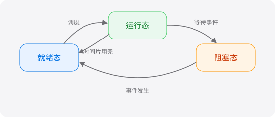

# 入门指南：如何使用本学习系统

欢迎使用 **Markdown 驱动的 AI 知识学习系统**。把任意 Markdown 文件放进 `learn/` 目录，左侧目录树会自动更新。

## 学习流程

1. **阅读**：在双页阅读模式中通读文章，使用 ← → 键或底部按钮翻页。
2. **练习**：点击「开始练习」，由 DeepSeek 根据当前文章生成选择题、原文挖空和问答题。
3. **复习反馈**：左侧对照原文，右侧查看解析与点评。

### 任务清单

- [x] 把资料放进 `learn/` 目录
- [x] 打开一篇文档开始阅读
- [ ] 完成一组练习
- [ ] 标记为「已完成」

## 支持的 Markdown 格式

这里展示常见格式：*斜体*、**粗体**、~~删除线~~、`行内代码`，以及[指向 TCP 协议的相对链接](计算机网络/TCP协议.md)和[外部链接](https://commonmark.org)。

> 引用块：学而不思则罔，思而不学则殆。
>
> —— 《论语》

| 模式 | 左栏 | 右栏 |
| :--- | :---: | ---: |
| 阅读 | 正文 | 正文（续） |
| 练习 | 题目 | 题目（续） |
| 复习反馈 | 原文 | 解析与点评 |

```ts
// 代码块会高亮显示，并且不会被挖空
function greet(name: string): string {
  return `你好，${name}！`;
}
```

---

本地图片（相对路径）：



带链接的图片（点击跳转）：

[](https://commonmark.org)

## 安全说明

Markdown 中的原始 HTML 会经过安全过滤，例如下面的脚本与危险链接都会被移除：

<script>alert('xss')</script>
<a href="javascript:alert(1)">危险链接</a>


<details>
<summary>点击展开：允许的安全 HTML</summary>

`<details>`、`<kbd>Ctrl</kbd>` 等无害标签会被保留：<kbd>Ctrl</kbd> + <kbd>C</kbd>。

</details>
